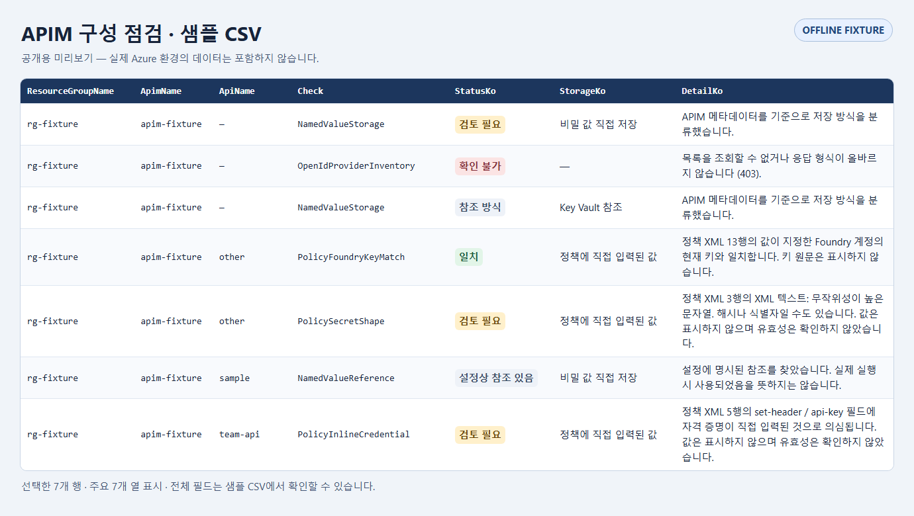

# Azure API Management 설정 및 자격 증명 점검

Azure API Management(APIM)의 설정을 Azure Resource Manager(ARM)에서 읽고, 결과를 Excel에서 열 수 있는 CSV로 저장하는 **참고용 PowerShell 샘플**입니다. Named Value가 어디에 저장되고 어느 정책에서 참조되는지, 정책에 키나 토큰이 직접 입력되어 있는지 확인할 수 있습니다.

> [!IMPORTANT]
> **실행 전에 읽어 주세요.**
>
> - **이 도구는 참고용 샘플입니다.** 스크립트와 점검 결과는 어떠한 명시적 또는 묵시적 보증 없이 제공됩니다. 결과를 보안·규정 준수 판정의 단독 근거로 사용하지 마세요.
> - **기존 APIM만 읽기 전용으로 점검합니다.** 새 리소스를 만들거나 Azure 설정을 변경하지 않으며, 게이트웨이도 호출하지 않습니다. 정책 실행 여부, 보안 공지의 영향 여부, 과거 자격 증명 노출은 판정하지 않습니다.
> - **탐지 0건이나 `NoMatch`는 안전 판정이 아닙니다.** `Unknown`·`Partial`은 확인하지 못한 범위가 있다는 뜻입니다. 권한과 조회 오류부터 확인하세요.
> - **Foundry 현재 키 대조는 별도 옵션입니다.** `-CompareFoundryKeys`는 추가 권한으로 실제 키를 조회해 메모리에서 비교합니다. 기본 점검은 `listKeys`·`listValue`를 호출하지 않습니다.
> - **실제 점검 CSV를 공개하지 마세요.** 키 원문은 기록하지 않지만 구독 ID, 내부 리소스 이름과 정책 경로가 포함될 수 있습니다.
>
> 자세한 내용은 [제약 사항](#제약-사항)과 [면책 고지](#면책-고지)를 참고하세요.

- [빠른 시작](#빠른-시작)
- [실행 옵션과 권한](#실행-옵션과-권한)
- [주요 점검 기능](#주요-점검-기능)
- [CSV 필드와 결과 해석](#csv-필드와-결과-해석)
- [터미널 출력과 오류 해석](#터미널-출력과-오류-해석)
- [제약 사항](#제약-사항)
- [면책 고지](#면책-고지)

## 빠른 시작

**준비물:** PowerShell 7.2 이상, Azure CLI(`az`), 점검할 APIM 리소스의 ARM 읽기 권한. [Audit-Apim.ps1](./Audit-Apim.ps1)과 [ApimAudit.psm1](./ApimAudit.psm1)은 같은 폴더에 둡니다. 모듈은 실행할 때 자동으로 로드됩니다.

스크립트가 있는 디렉터리의 PowerShell에서 실행합니다. Azure CLI에 이미 로그인한 상태라면 `az login`은 생략할 수 있습니다. 이 문서의 `<...>`는 자리표시자입니다. 이미 보유하거나 점검 권한이 있는 Azure 리소스의 값으로 바꾸세요.

```powershell
az login
az account show --query '{name:name,id:id,tenantId:tenantId}' -o table

.\Audit-Apim.ps1 -ApimName '<APIM_NAME>'
```

점검이 끝나면 현재 디렉터리에 `apim-audit.csv`가 생성되고, 터미널에는 `Check`와 `Status` 조합별 결과 행 수가 표시됩니다.

## 실행 옵션과 권한

### 점검 대상 선택

아래 세 방식 중 **하나만** 사용합니다. 리소스 그룹 모드는 조회 가능한 APIM 인스턴스를 하나의 CSV에 기록합니다.

```powershell
# APIM 이름으로 한 인스턴스 점검
.\Audit-Apim.ps1 -ApimName '<APIM_NAME>' `
  -OutputPath '.\apim-audit-by-name.csv'

# 리소스 그룹 내 조회 가능한 APIM 인스턴스 모두 점검
.\Audit-Apim.ps1 -ResourceGroupName '<RESOURCE_GROUP_NAME>' `
  -OutputPath '.\apim-audit-by-rg.csv'

# 전체 리소스 ID로 한 인스턴스 점검
$subscriptionId = '<SUBSCRIPTION_ID>'
$resourceGroupName = '<RESOURCE_GROUP_NAME>'
$apimName = '<APIM_NAME>'
$apimId = "/subscriptions/$subscriptionId/resourceGroups/$resourceGroupName/providers/Microsoft.ApiManagement/service/$apimName"
.\Audit-Apim.ps1 -ApimResourceId $apimId -OutputPath '.\apim-audit-by-id.csv'
```

| 매개변수 | 의미 |
|---|---|
| `-ApimName` | 구독에서 APIM 리소스 이름으로 검색합니다. |
| `-ResourceGroupName` (`-RgName`) | 지정한 리소스 그룹에서 APIM 인스턴스를 검색합니다. |
| `-ApimResourceId` | `/subscriptions/.../resourceGroups/.../providers/Microsoft.ApiManagement/service/...` 형식의 전체 ID입니다. 구독은 이 ID에서 결정됩니다. |
| `-SubscriptionId` | 이름 또는 리소스 그룹 검색에 사용할 구독 GUID입니다. 생략하면 Azure CLI의 현재 구독을 사용합니다. 스크립트는 현재 구독을 변경하지 않습니다. |
| `-OutputPath` | CSV 경로입니다. 기본값은 `.\apim-audit.csv`입니다. 기존 파일은 덮어쓰므로 이력을 보존하려면 다른 파일명을 사용하세요. |
| `-CompareFoundryKeys` / `-FoundryResourceId` | 단일 APIM과 같은 구독의 `OpenAI` 또는 `AIServices` 계정 하나를 지정해 현재 키와 대조합니다. 아래 권한이 필요합니다. |

기본 점검에는 APIM 서비스, API·정책, 필요한 워크스페이스 등 점검 대상의 **구성 읽기 권한**이 필요합니다. 이름 또는 리소스 그룹으로 실행할 때는 해당 범위에서 APIM 목록도 조회할 수 있어야 합니다. 일반 모드는 비밀 값 조회 작업(`listValue`, `listKeys`)을 호출하지 않지만, **정책에 평문으로 적힌 값은 정책 XML 조회 응답에 포함될 수 있습니다.** 보고서에는 탐지한 값 원문을 쓰지 않습니다.

### 선택 사항: Foundry 계정의 현재 키와 정확히 대조

자격 증명 조회 권한과 별도 점검 승인이 있는 경우에만 사용합니다. `$apimId`는 앞의 전체 리소스 ID 예시 또는 실제 APIM ID로 설정합니다. Foundry의 프로젝트 URL이나 모델 배포명이 아니라 **계정의 ARM 리소스 ID**를 지정합니다. 키 원문은 명령에 입력하지 않습니다.

```powershell
$foundryResourceGroupName = '<FOUNDRY_RESOURCE_GROUP_NAME>'
$foundryAccountName = '<FOUNDRY_ACCOUNT_NAME>'
$foundryId = "/subscriptions/$subscriptionId/resourceGroups/$foundryResourceGroupName/providers/Microsoft.CognitiveServices/accounts/$foundryAccountName"

.\Audit-Apim.ps1 -ApimResourceId $apimId -FoundryResourceId $foundryId `
  -CompareFoundryKeys -OutputPath '.\apim-audit-with-key-comparison.csv'
```

- `Microsoft.CognitiveServices/accounts/listKeys/action`: 선택한 Foundry 계정의 현재 두 키를 조회합니다.
- `Microsoft.ApiManagement/service/namedValues/listValue/action`: APIM **서비스 범위**에 직접 저장된 Named Value의 값을 대조할 때 사용합니다. 워크스페이스 Named Value 및 Key Vault 참조 값은 이 방식으로 읽지 않습니다.
- 비교는 메모리에서 수행합니다. 정책의 경우 필드명과 무관하게 XML 속성·텍스트의 **전체 값**을 대소문자까지 비교합니다. `Bearer <key>`는 토큰 부분만 비교합니다. 더 큰 문자열에 포함된 키, 동적으로 생성되는 값, 교체 전 키 및 다른 Foundry 계정의 키는 대조하지 않습니다.
- 결과는 `FoundryKeyMatch`(Named Value)와 `PolicyFoundryKeyMatch`(정책)에서 확인합니다. 키 조회 실패는 일치 항목이 없다는 뜻이 아니므로 `Unknown`으로 표시됩니다.

## 주요 점검 기능

| `Check` | 점검 범위와 의미 |
|---|---|
| `ServiceSku`, `VnetIntegration`, `PublicNetworkAccess`, `LegacyDirectManagementApi` | APIM 계층, 기본 지역 VNet 연결 설정, 공개 네트워크 액세스 속성, 기존 직접 관리 API 설정을 확인합니다. 네트워크에서 실제로 연결되는지는 시험하지 않습니다. |
| `IdentityProviderInventory`, `OpenIdProviderInventory`, `ApimSubscriptionInventory` | 인증 공급자, OpenID Connect 공급자, APIM 구독의 구성 개수를 확인합니다. 클라이언트 비밀 값, 구독 키 원문, 교체 여부는 확인하지 않습니다. |
| `WorkspaceInventory`, `ApiInventory`, `ApiRevisionCoverage`, `ApiOperationCoverage` | 접근 가능한 워크스페이스·API·리비전·오퍼레이션과 점검 범위를 기록합니다. 자격 증명 후보가 없어도 이 행은 남습니다. |
| `NamedValueInventory`, `NamedValueStorage`, `NamedValueReference` | Named Value의 목록과 저장 방식을 확인하고, 정책·정책 조각·Backend의 조회 가능한 속성에서 `{{이름}}` 형식의 참조를 찾습니다. |
| `PolicyInlineCredential` | 알려진 헤더와 쿼리 매개변수에 직접 입력된 값을 찾습니다. 예: `api-key`, `Ocp-Apim-Subscription-Key`, `Authorization: Bearer` 또는 `Basic`, `client_secret`, `authentication-basic` 비밀번호. |
| `PolicySecretShape` | 필드명에 의존하지 않고 XML 텍스트·속성의 값 형태를 검사합니다. 예: JWT 유사 형식, Azure Storage `AccountKey=`, 일부 GitHub·Stripe 토큰 접두사, 개인 키 시작 표식, 무작위성이 높은 문자열. |
| `FoundryKeyMatch`, `PolicyFoundryKeyMatch` | 명시적 옵션으로 수행하는 현재 Foundry 키 대조입니다. `FoundryKeyMatch / NotRequested`는 대조가 실행되지 않았음을 뜻합니다. |
| `ReferenceCoverage` | 서비스 및 조회 가능한 워크스페이스의 정적 점검 범위와 조회 실패를 기록합니다. 조회 실패가 있으면 개별 실패 경로와 요약을 함께 확인하세요. |

정책 검사는 서비스 전역, 제품, API·리비전, 오퍼레이션, 정책 조각에 적용되며, 조회 가능한 워크스페이스도 포함합니다. 한 리터럴은 필드 기반 검사와 값 형태 검사에 **동시에** 잡힐 수 있습니다.

## CSV 필드와 결과 해석

CSV는 **리소스 그룹 → APIM → API → 점검 항목 → 상태 → 저장 방식** 순서로 시작합니다. 각 APIM에서 API에 속하지 않는 서비스 범위 행이 먼저 나오고, 이후 같은 API의 행이 모여 있습니다. Excel에서 머리글에 필터를 걸어 리소스 그룹, APIM, API, `Check` 순서로 범위를 좁히면 됩니다. 한글이 깨지면 Excel의 **데이터 → 텍스트/CSV에서**로 가져와 UTF-8과 쉼표 구분을 선택하세요.

아래는 [공개용 샘플 CSV](./docs/apim-audit-sample.csv)의 주요 열을 표시한 화면입니다. 오프라인 모의 테스트 결과만 사용했으며, 실제 Azure 구독·리소스·자격 증명은 포함하지 않습니다.



| 필드 | 해석 |
|---|---|
| `ResourceGroupName`, `ApimName` | Azure 리소스 그룹과 APIM 인스턴스 이름입니다. |
| `ApiName` | API 표시 이름이 아니라 ARM 리소스 이름입니다. API에 속하지 않는 점검은 빈칸입니다. Named Value 참조 행에서는 참조하는 API 이름을 표시합니다. |
| `Check`, `Status`, `Storage` | 점검 코드, 결과 상태, 저장 방식입니다. 기존 필터와 자동화를 위해 영어 코드로 유지합니다. |
| `StatusKo`, `StorageKo` | 상태와 저장 방식의 한글 표시입니다. 저장 방식이 없는 점검은 `Storage`와 `StorageKo`가 모두 비어 있습니다. |
| `WorkspaceName`, `ApiRevision`, `OperationName` | 하위 범위입니다. `ApiRevision`은 경로에 `;rev=`가 명시된 경우만 채워집니다. 빈칸은 리비전 점검 실패를 뜻하지 않습니다. |
| `ResourceName` | 점검 대상의 이름입니다. 예를 들어 API가 Named Value를 참조하는 행의 `ResourceName`은 API가 아니라 Named Value 이름입니다. |
| `ReferenceType` | 참조 또는 탐지 위치의 유형입니다. 예: `Policy`, `Fragment`, `Backend`. |
| `DetailKo`, `Detail` | 한국어 설명이 영어 설명 바로 앞에 나옵니다. 원인, 조회 건수, 정책 XML 줄 번호, 오류 상태 코드 등이 포함될 수 있습니다. 줄 번호는 Azure가 반환한 XML 기준입니다. |
| `Target`, `ReferencedBy` | `Target`은 점검 대상 경로, `ReferencedBy`는 그 대상을 참조하는 정책 또는 Backend 경로입니다. 정책에 직접 적힌 값의 탐지 행은 정책 경로를 `Target`에서 확인합니다. |
| `Source`, `CheckedAtUtc`, `ApimResourceId` | 결과 출처(실제 점검은 `Azure`, 공개용 샘플은 `Fixture`), 점검 기준 시각(UTC), APIM 전체 리소스 ID입니다. |

**주요 상태 해석**

| 상태 | 읽는 방법 |
|---|---|
| `Review` / 검토 필요 | 확인이 필요한 설정 또는 후보입니다. `Check`와 함께 읽으세요. 예를 들어 공급자 목록의 `Review`는 공급자가 구성되어 있다는 뜻이고, 평문 키 탐지의 `Review`는 자격 증명 후보라는 뜻입니다. |
| `Match` / 일치, `NoMatch` / 불일치 | 대조한 범위에서 일치 여부를 뜻합니다. 정책의 `Match`는 현재 키와 동일한 값이 설정에 있다는 뜻이지, 그 키를 실제로 사용했다는 증거가 아닙니다. |
| `Unknown` / 확인 불가, `Partial` / 부분 확인 | 권한, ARM 응답, XML 파싱 등의 이유로 확인이 불완전합니다. `Target`, `DetailKo`를 보고 점검 가능한 범위를 확인하세요. |
| `StaticReference` / 설정상 참조 있음, `NoStaticReference` / 설정상 참조 미발견 | 조회한 설정에서 대상 참조를 찾았거나 찾지 못했다는 뜻입니다. 실행 여부 또는 미사용 여부를 확정하지 않습니다. |
| `Inspected`, `Complete`, `Discovered`, `StaticOnly` | 오퍼레이션 점검, 목록 조회, API 발견 또는 정적 점검이 이루어졌음을 뜻합니다. 보안상 문제가 없다는 판정은 아닙니다. |
| `NoneFound`, `Inventory`, `Referenced` | 해당 항목이 발견되지 않았거나, 목록을 확인했거나, 참조 방식으로 구성되었다는 뜻입니다. 어느 항목의 상태인지는 `Check`와 `Storage`를 함께 확인합니다. |
| `NotRequested`, `NotApplicable` | 대조를 요청하지 않았거나 적용 대상이 아닙니다. 예: 선택한 Foundry 계정에서 로컬 키 인증이 비활성화된 경우. |
| `DeveloperClassic`, `Classic`, `V2`, `OtherSku` | APIM 계층 분류입니다. 공지의 영향 여부를 판정한 값이 아닙니다. |
| `NoVnetIntegration`, `SubnetConfigured`, `Enabled`, `Disabled` | VNet 통합 여부, 서브넷 구성 여부 또는 해당 설정의 사용 여부입니다. 실제 네트워크 연결 여부는 의미하지 않습니다. |

**주요 저장 방식 해석**

| `Storage` | 의미 |
|---|---|
| `KeyVaultReference` | Key Vault 참조로 구성되어 있습니다. 참조된 비밀 값 자체는 조회하지 않습니다. |
| `DirectSecret` | Named Value가 비밀 값으로 표시되어 APIM에 직접 저장되어 있습니다. Key Vault 참조는 아닙니다. |
| `DirectPlainText` | Named Value가 비밀로 표시되지 않은 값으로 APIM에 직접 저장되어 있습니다. 이 분류만으로 값이 자격 증명이라고 판단하지 않습니다. |
| `PolicyLiteral` | 정책 안의 직접 입력 값입니다. 탐지 근거와 일치 여부는 `Check`, `Status`, `DetailKo`를 함께 확인합니다. |
| `Unknown` | 메타데이터로 저장 방식을 확인하지 못했습니다. |

**권장 검토 순서:** 먼저 `Unknown`·`Partial`을 확인해 점검 누락을 파악합니다. 이후 `PolicyFoundryKeyMatch` 또는 `FoundryKeyMatch`의 `Match`와 `PolicyInlineCredential`·`PolicySecretShape`의 `Review`를 검토합니다. 마지막으로 `NamedValueStorage`와 `NamedValueReference`를 함께 확인해 저장 방식과 참조 위치를 연결합니다. `HighEntropyToken` 후보는 해시나 식별자일 수 있으므로 그 자체로 키라고 확정하지 마세요.

## 터미널 출력과 오류 해석

터미널의 `Name`, `Count`는 **점검 코드와 상태별 CSV 행 수**입니다. 예를 들어 `PolicyInlineCredential, Review`가 3이면 해당 점검의 결과 행이 3개라는 뜻이며, 서로 다른 실제 키가 3개라는 뜻은 아닙니다. `-OutputPath`는 저장 경로만 지정합니다. 이미 생성된 CSV는 다시 Azure에 접속하지 않고 확인할 수 있습니다.

```powershell
Import-Csv -LiteralPath '.\apim-audit-by-name.csv' |
    Where-Object { $_.Status -in @('Review', 'Match', 'Unknown', 'Partial') } |
    Format-Table ApimName, ApiName, Check, StatusKo, DetailKo -AutoSize -Wrap
```

| 증상 | 확인할 사항 |
|---|---|
| CLI 로그인 또는 구독을 확인할 수 없음 | `az account show`로 계정과 구독을 확인하고, 필요하면 다시 로그인하거나 이름 검색에 `-SubscriptionId`를 지정합니다. |
| APIM을 찾을 수 없음 | 해당 구독과 리소스 그룹에 리소스가 있는지, 이름과 ARM 읽기 권한이 맞는지 확인합니다. 검색 범위가 불명확하면 전체 `-ApimResourceId`를 사용합니다. |
| `DetailKo`에 HTTP `401` 또는 `403` | `Target`을 확인합니다. `401`은 인증 세션과 테넌트를, `403`은 해당 리소스의 RBAC 권한과 선택적 키 조회 작업 권한을 확인합니다. |
| HTTP `400` 또는 `404` | `400`이면 대상 계층에서 해당 기능과 ARM 경로를 지원하는지 확인합니다. `404`는 경로에 따라 의미가 다릅니다. 일반 범위에 로컬 정책이 없어 반환된 `404`는 별도 오류 행을 만들지 않지만, 목록이나 정책 조각 조회에 실패하면 확인 누락으로 기록될 수 있습니다. |
| `RequestFailed`, `InvalidJson`, 잘못된 페이지 링크 또는 XML 파싱 오류 | 네트워크·프록시, 응답 형식, 조회 대상 정책을 확인합니다. 해당 행은 점검 통과가 아니라 미확인입니다. |
| 실행이 중단되거나 CSV를 쓰지 못함 | 터미널 오류, 출력 폴더 및 파일 권한, Excel에서 파일을 열어 잠근 상태인지 확인합니다. 재실행 전 `CheckedAtUtc`를 확인해 오래된 CSV를 새 결과로 혼동하지 마세요. |

이 요약과 CSV는 **스크립트의 구성 점검 결과**이며, Azure Monitor 요청 로그나 Activity Log를 수집한 것이 아닙니다. 사고 조사가 필요하면 Azure Activity Log에서 관리 작업을, 진단 설정으로 수집한 APIM 게이트웨이 로그와 Backend 로그에서 요청 기록을 별도로 확인하세요. 로그 수집 여부와 보존 기간에 따라 과거 기록이 없을 수 있습니다. 구독에 적용되는 보안 공지와 공식 조치는 [Azure Service Health](https://portal.azure.com/#view/Microsoft_Azure_Health/AzureHealthBrowseBlade)에서 확인하세요.

## 제약 사항

- **정적 점검입니다.** 정책 상속으로 최종 적용된 정책, 조건 분기, APIM 표현식 실행, 동적 문자열 조합, 실시간 요청·응답은 평가하지 않습니다. 정책에 적힌 값이나 참조가 실제 실행에 사용되었는지는 이 보고서로 확인할 수 없습니다.
- **탐지 규칙에 한계가 있습니다.** 알려진 필드와 값 형태에 의존하므로 평범한 문자열 형태의 키, 미지원 토큰 형식, 인코딩되거나 분할된 값, 마스킹된 Backend 자격 증명 등을 놓칠 수 있습니다. 재사용 가능한 인증 흐름과 임의의 Backend 직접 입력 자격 증명에 대한 전수 검사는 하지 않습니다. 결과가 0건이어도 자격 증명이 없다는 뜻은 아닙니다.
- **권한과 계층에 따라 조회 범위가 달라집니다.** 접근 가능한 서비스와 워크스페이스만 확인할 수 있습니다. 기본 지역 네트워크 설정만 읽으며, NSG·라우팅·DNS나 실제 도달 가능성은 검증하지 않습니다.
- **사고 조사나 조치를 대신하지 않습니다.** 탐지 행은 설정 점검 시점의 결과입니다. 영향 대상의 자격 증명 교체와 과거 접근 이력 조사는 [Azure Service Health](https://portal.azure.com/#view/Microsoft_Azure_Health/AzureHealthBrowseBlade) 및 [Microsoft APIM 보안 권고](https://learn.microsoft.com/azure/api-management/secure-api-management)에 따라 별도로 진행하세요.
- **실제 환경의 출력은 공개하지 마세요.** CSV에는 키 원문을 기록하지 않지만 구독 ID, 리소스 이름, 정책 경로 등 내부 정보가 포함될 수 있습니다. 공개용 샘플을 제외한 CSV는 Git에서 기본 제외되며, 실제 환경의 CLI 출력이나 배포 매개변수도 게시하지 마세요.

## 면책 고지

이 샘플과 실행 결과는 참고 목적으로 **있는 그대로(AS IS)** 제공됩니다. 결과의 정확성, 완전성, 최신성, 탐지 범위 또는 특정 목적에 대한 적합성을 포함하여 **어떠한 명시적 또는 묵시적 보증도 하지 않습니다.**

이 결과는 공식 보안 평가, 규정 준수 인증 또는 사고 조사 결과가 아닙니다. 실제 문제가 탐지되지 않거나 정상 설정이 문제 후보로 표시될 수 있습니다. 보안 조치를 결정하기 전에 실제 구성, 관련 로그, 공식 Azure 보안 공지를 별도로 확인하세요. 관련 법령이 허용하는 범위에서, 제공자는 이 샘플을 사용하거나 결과에 의존하여 발생한 손해에 대해 책임을 지지 않습니다.
